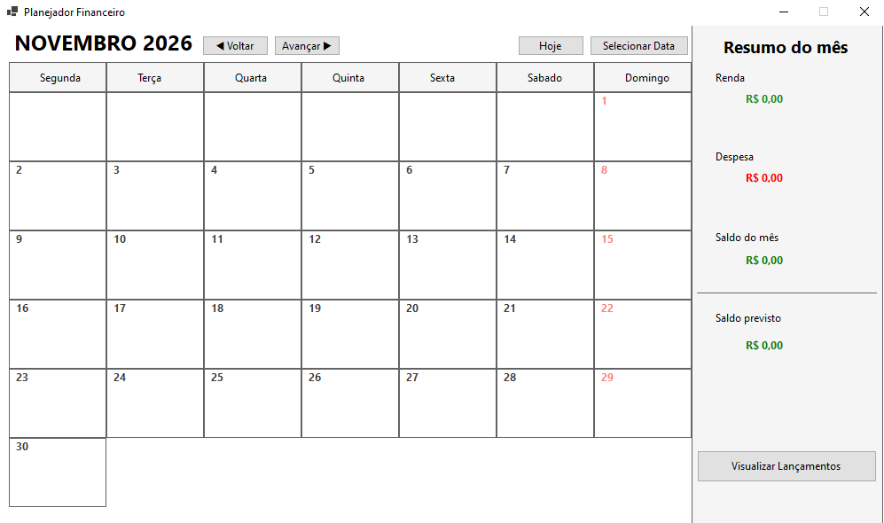
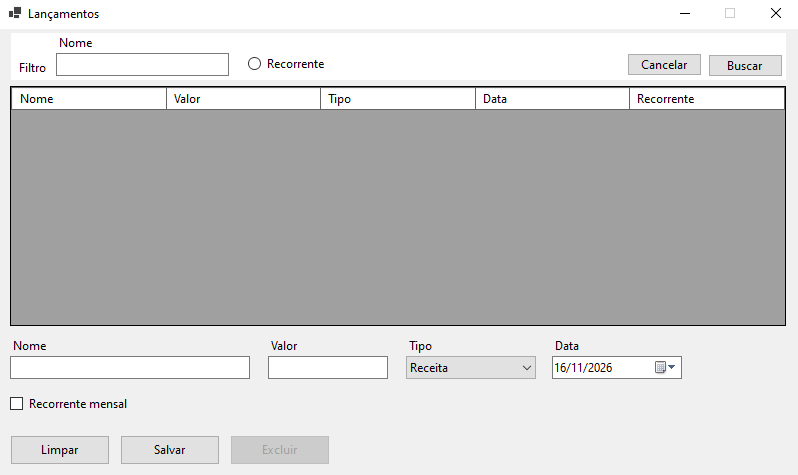

# SIGEFP - Sistema de Gestão Financeira Pessoal

## 1. Título do Projeto

**SIGEFP - Sistema de Gestão Financeira Pessoal**

---

## 2. Descrição do Projeto

O SIGEFP (Sistema de Gestão Financeira Pessoal) é uma aplicação desktop desenvolvida com o objetivo de auxiliar usuários no controle, acompanhamento e planejamento de suas finanças pessoais.

Atualmente, muitas pessoas enfrentam dificuldades para registrar receitas e despesas, acompanhar seus gastos e manter uma organização financeira eficiente. A falta desse controle pode resultar em endividamento, dificuldade para atingir metas financeiras e problemas no gerenciamento do orçamento pessoal.

Diante desse cenário, o SIGEFP foi idealizado como uma ferramenta prática e intuitiva para auxiliar no registro e gerenciamento de movimentações financeiras, permitindo que o usuário acompanhe sua situação financeira em tempo real e tome decisões mais conscientes sobre seus recursos.

## 3. Objetivo do Projeto

### Objetivo Geral

Desenvolver uma aplicação capaz de auxiliar usuários no gerenciamento e planejamento de suas finanças pessoais.

### Objetivos Específicos

- Registrar receitas e despesas.
- Permitir o acompanhamento do saldo disponível.
- Organizar eventos financeiros.
- Facilitar a visualização das informações financeiras.
- Fornecer uma interface simples e intuitiva.

## 4. Público-Alvo

O sistema é destinado a pessoas que desejam organizar suas finanças pessoais, controlar gastos e acompanhar sua situação financeira de forma prática.

## 5. Principais Funcionalidades

- Cadastro de receitas.
- Cadastro de despesas.
- Controle de lançamentos recorrentes.
- Visualização do saldo atualizado.
- Gerenciamento de eventos financeiros.
- Consulta de movimentações financeiras.
- Atualização de registros existentes.
- Exclusão de registros.
- Navegação por datas.
- Visualização consolidada de lançamentos.

---

## 6. Tecnologias Usadas

- C#
- .NET
- Windows Forms
- Github Copilot

## 7. Esboço do Projeto (Layout)

### Tela Principal

### Tela de Gerenciamento

# Como Baixar

Acesse a página de Releases:

https://github.com/Thug-Okami/planejador_financeiro/releases

Baixe a versão do arquivo .zip mais recente disponível.

# Como Utilizar

1. Baixe o arquivo da Release
2. Extraia o conteúdo do arquivo ZIP
3. Execute o planejador_financeiroCS.exe (por ser um arquivo .exe, é normal que o windows reclame)
4. Ao abrir o aplicativo, você pode adicionar lançamentos ao clicar no espaço em branco das datas
5. Defina o nome, valor, tipo e se o lançamento é recorrente ou não no card ao aparecer
6. Acompanhe o saldo e histórico financeiro no lado direito da tela
7. controle a visualização de datas com os botões no topo da tela (Voltar,Avançar,Hoje e Selecionar Data)
8. Tenha uma visualização geral dos lançamentos no botão inferior direito "Visualizar Lançamentos"
9. Delete ou Atualize lançamentos existentes a partir dessa tela

# Integrantes

- Michaell Senna Amaral Cordeiro

# Licença

Projeto acadêmico desenvolvido para a disciplina Projeto Integrador do segundo semestre do curso de ADS na Fatec Zona Sul.
